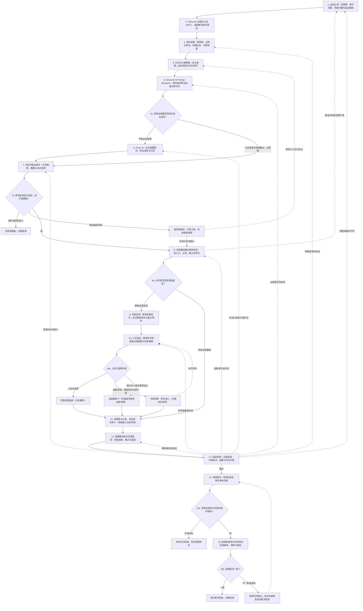
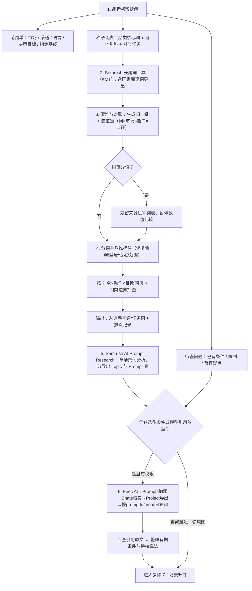
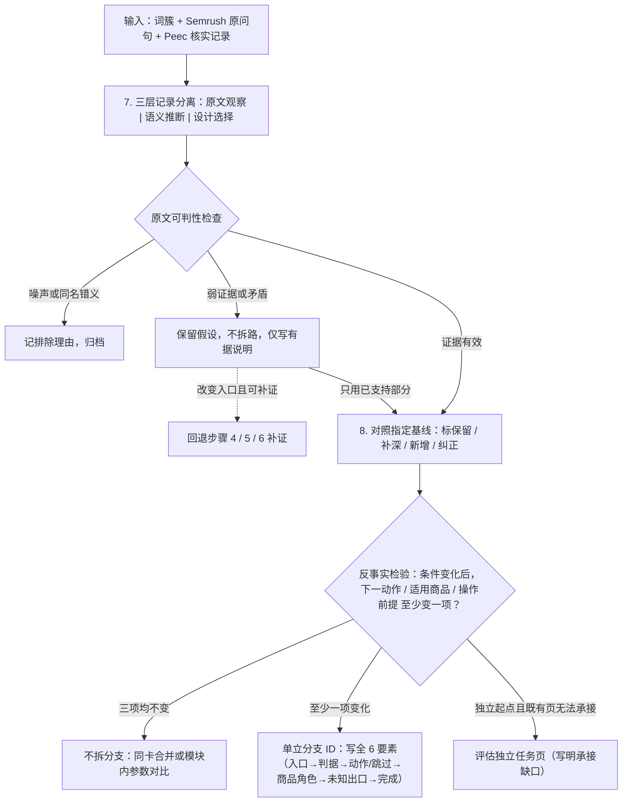
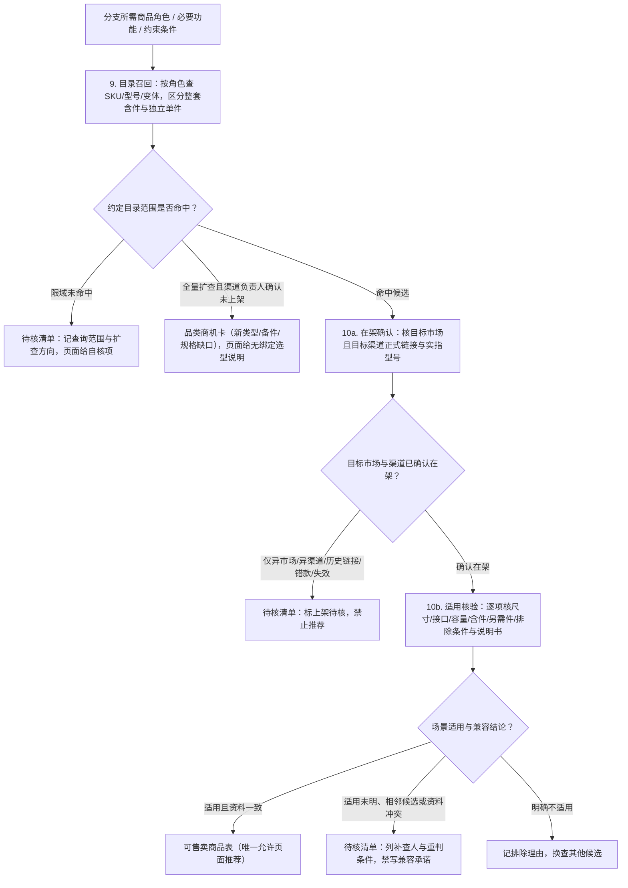
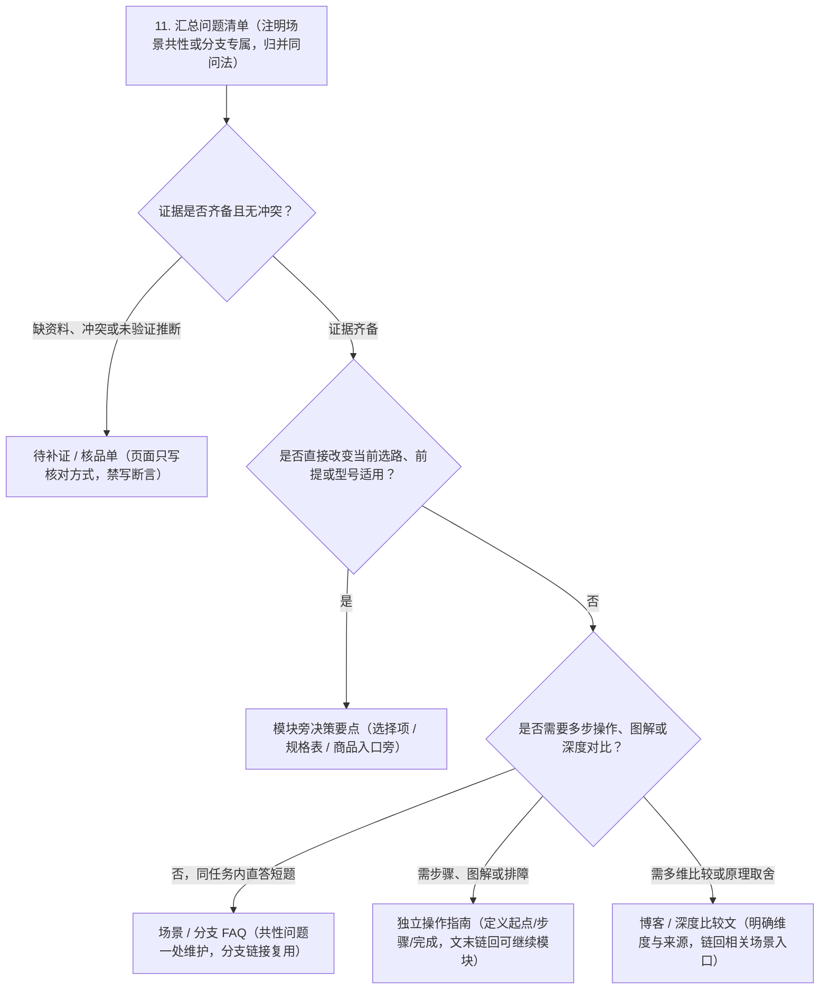

# 场景研究与页面搭建 SOP

**品运初稿 → Semrush 长尾词 → Semrush AI 提示词 → Peec AI 补充提问 → 场景与分支 → 商品与页面 → 验收交付**

[配套 Skill](./skills/scene-page-workflow/SKILL.md) · [公开项目报告](../index.html) · [需求证据样例](../基础需求证据.csv) · [流程参考稿](./资料/GARVEE%20枯枝原木处理场景研究流程说明.docx)

## 一、端到端总流程与红线

实线按阶段推进；虚线表示缺证、冲突或验收不通过时的精准回退目标。



**四条流程红线（全流程适用）**

|红线项|硬性判定标准|禁止行为|正确处置|
|---|---|---|---|
|可售卖定义|目标市场 **且** 目标渠道已上架 **且** 当前分支适用，三者缺一不可|仅凭目录命中、异市场/异渠道链接或历史链接直接推荐|在架与适用分别留证；缺任一关进待核清单或商机卡|
|读数口径隔离|关键词月估算、AI 主题估值、问句附带估值、Peec 运行数属不同层级|跨层相加、跨模型求和、对冲突值取均值、把估值当真实流量|按原始层级分列标注；同键异值双留来源并暂停该数值比较|
|两类提示词区分|**研究提示词**（步骤 5/6 收录或监测）≠ **生成任务卡**（步骤 11 约束产出）|把模型回答当客观事实，或把内部配置题直接当作用户搜索需求|模型说法须回查引用原文或商品资料；页面只采信可追溯原词/原问句|
|发布授权门禁|无该版本与目标的明确发布授权时，流程止于步骤 14 本地交接|默认外发、未回读即对外确认、状态未知时整包重发|回读目标位版本、文件清单与指纹；异常先核查外部实际状态|

**核心术语速查（一句话看懂专业名词）**

|术语|一句话释义|所在步骤|
|---|---|---|
|种子词（Seed）|从品运初稿提炼的产品核心词、当地别称或任务词，用作 Semrush 扩词起点|1–2|
|归一键 / 去重键|`归一键`按语言统一大小写和空格；`去重键`=`归一键+市场+窗口+口径`，用于同口径去重|3|
|同键异值|同一去重键出现多个不同数值时，双留来源进冲突表，不取均值、暂停该数值比较|3|
|八维标注与主意图|按核心词/场景/动作/材料/配件/属性适配/比较选购/用户问题多选标注，另定唯一主意图|4|
|AI Topic / Prompt|Semrush 中 `Topic` 为主题聚合估值，`Prompt` 为具体原问句；两者数值分层，不可相加|5|
|配置题 / 运行数|Peec 中团队配置的监测问题（`promptId`）及各次回答记录（`runId`），仅作观察线索，非流量|6|
|观察 / 推断 / 选择|`原文观察`为词句字面；`语义推断`为条件推测；`设计选择`为页面落点决定，三者分栏不混写|7|
|指定基线|旧版方案互相冲突时，由范围负责人书面指定的唯一比对起点版本|1、8|
|反事实检验|假设条件改变后，检验**下一动作、适用商品、操作前提**是否实质变化；均不变则不拆分支|8|
|整套含件 vs 单件|随主机打包附带的部件（不可单买）与独立上架售卖的备件/配件，核品时必须分开登记|9–10|
|可售卖 vs 限域未命中|`可售卖`须满足目标市场+渠道已上架且适用；`限域未命中`指仅部分目录未查到，进待核|10|
|served 型号 / 指纹|`served 型号`指模型复审时服务端实际响应版本；`指纹`指文件校验哈希或版本号，用于核对一致|14–15|

## 二、分阶段执行结构与决策树

### 1. 阶段一：立项与数据采集（步骤 1–6）



|步骤与角色|输入|核心操作|判断关口与产出|回退条件|
|---|---|---|---|---|
|1　品运立项|品运初稿、品类任务、目标市场与渠道、现有页面|拆出**范围单、种子词表、待查问题**三清单；标明已确认、待核、假设与指定基线|说清市场、渠道、用户与页面决策目标 → 三清单与基线|范围含混先确认；无权限先做获准部分|
|2　研究采集|范围单、种子词、工具权限|**Keyword Magic Tool** 选目标国家库 → 逐词查 → All Keywords → Export；记日期、窗口与截断|资料可定位，区分完整/部分/空表/不可读 → 来源清单与原表|缺表先登记覆盖缺口，不擅自推断全量|
|3　研究清洗|原始词表、来源清单|文本格式导入防丢前导零；建立归一键与去重键；执行对账公式并分离冲突数值|同键同值仅引 1 次，异值进冲突表 → 有效词表、重复映射、冲突清单|原值冲突暂停数值比较，原词仍入语义审读|
|4　研究+品运选词|有效词表、长尾原文|保复合词/型号/否定/范围分词；标**八维标签**与**主意图**；`对象×动作×目标`聚类并抽查四类边界词|说清谁在做什么及什么条件改变选路 → 带源行词簇、排除记录、场景词表|过宽拆对象动作，过窄扩当地别称；纯品名继续挖动作词|
|5　研究查 AI 问句|入选场景词、待答问题|核实入口为 **AI Prompt Research**（非 SEO Topic Research）；每次 1 词 Analyze；分导 Topic 与 Prompt 表|问句挂回对应主题且关联选择分支 → 主题-问句对应表、待追问清单|未命中扩同义词；无导出功能时逐页摘录并标部分覆盖|
|6　研究按需监测|未答清问题、Peec 权限|标注题目来源（原句/改写/新增）；`Prompts→Add` 设国家/主题/角色；`Chats` 核答；`Project` 导出后按 `promptId`+`created` 筛窗|观察能改变页面回答，区分配置题与逐次运行 → 问答对照、引用核查单|仅历史窗口须注明；无权限或不影响决策直接跳过并记因|

**工具配置与可替换矩阵**

|步骤|默认工具与入口|必留原始字段|可替换前提|严禁操作|
|---|---|---|---|---|
|2|Semrush **Keyword Magic Tool**（目标国家库 → All Keywords）|`Keyword`、`Volume`、`Intent` 及全原列|同市场同口径词库工具，须登记入口与窗口|跨市场混导、丢失源行号或过滤条件|
|5|Semrush **AI Prompt Research**（Enter a topic → Analyze）|Topic 表：`name, prompts_count, volume, volume_trend, intents, topic_id`<br/>Prompt 表：`prompt, llm, topic_id, topic_name, topic_volume`|具有主题与原始问句导出的 AI 问答研究工具|误用 SEO Topic Research、缺 ID 时强行错配|
|6|Peec AI（**Prompts** → **Chats** → **Project** 导出）|`promptId`、`model`、`user`、`assistant`、`created`、`sources`、`sourceUrls`、`citations`、`mentions`|有国家/角色/模型切片且可导出引用的监测工具|用全量导出充当当期窗口、把无引用回答当事实|

**研究台账读数口径与清洗对账（四层隔离）**

|记录层级|唯一键构成|数值口径与单位|允许用于何种决策|
|---|---|---|---|
|搜索关键词|`归一词 + 市场 + 窗口 + 口径`|该市场估算月搜索量 `Volume`（零值照录，空值记未提供）|识别用户表达、核心对象/动作及长尾约束|
|AI 主题|`topic_id/核实名称 + 市场 + 时期 + 来源`|主题层级 `volume`（周期未明示写“主题估值，周期未注明”）|筛选需下钻读取原问句的高相关主题|
|AI 原问句|`prompt + topic_id + llm + 批次`|`topic_volume` 标“所附主题/模型估值”，与主题总值分列|提取选型比较维度、前置条件与待答问题|
|配置题与回答|题：`promptId + 版本 + 角色`<br/>答：唯一 `runId` / 运行键|源无流量估值写“未提供”；题目数与运行次数分别计数|核查模型覆盖与回答分歧，把缺口转为资料需求|

- **清洗对账公式**：`输入行数 = 有效行数 + 本次规则排除行数`；有完整键的有效行内 `重复附加行数 = 有键行数 − 唯一键数`；跨簇复用按 `证据ID` 核重。
- **八维标注维度**：`核心词` / `场景` / `动作` / `材料` / `配件` / `属性适配` / `比较选购` / `用户问题`（可多选，另配单选主意图及理由）。
- **四类必抽查样本**：头部高频词、低量高约束词、跨簇交叉命中词、边界反例词。

### 2. 阶段二：场景归并与路径分流（步骤 7–8）



|步骤与角色|输入|核心操作|判断关口与产出|回退条件|
|---|---|---|---|---|
|7　研究归并证据卡|词簇、问句、可用监测、排除记录|并排读原词与问法，写对象/已有状态/目标/动作/限制；严格分列**原文观察、语义推断、设计选择**及反例|能指出哪段原文改变下一步，购物/比较/信息/服务分开标记 → 场景证据卡、未决问题、建议入口|孤立词或仅模型自述留待核假设；不足拆路就地说明；纯臆测搁置|
|8　品运+内容定路径|场景证据卡、指定基线版本|定位旧稿块或表行写差异处置；做**反事实检验**确定分支；画全进入状态、判据、跳过、未知出口与终点|目标/动作变才独立入口；已有设备跳选购；参数未知给核对+继续阅读 → 路径图、基线差异表|旧稿冲突退步骤 1 定基线；无旧稿标未能比对；争议能力承诺先撤下|

**分支定义六要素（每条 `分支ID` 必填）**：`进入状态` → `选择题与分流判据` → `下一动作 / 可跳步骤` → `适用商品角色` → `参数未知出口` → `完成标志`。

### 3. 阶段三：三关核品与页面搭建（步骤 9–12）





|步骤与角色|输入|核心操作|判断关口与产出|回退条件|
|---|---|---|---|---|
|9　品类查目录|动作、前提、所需功能与约束|按别名/类目/型号/配件检索约定目录，留查询式、源行、SKU、变体，分开整套含件与独立上架件|命中可定位型号，用途可逐项比对 → 动作-目录匹配表|仅有相邻用途转核品；限域未命中写清范围与扩查方向；纯信息路径直入步骤 11|
|10　品类核在架与适用|匹配表、商品页、含件清单、说明书|分步核实**目录身份 → 目标市场渠道在架链接 → 场景适用参数**；行业/安全说法查地域/对象/日期正文|仅上架且适用进推荐；确认未上架且需求成立建商机 → 可售卖表、商机表、待核清单|标清四类待核原因（缺用途/相邻/限域未命中/冲突），回填后重判；期间撤下未证实承诺|
|11　内容负责人发任务卡|批准证据卡、路径表、可写商品字段与缺口|指定受众、语言、交付形态、冻结输入、可引用字段、禁写承诺、模块顺序与验收动作|每条关键判断有 `证据ID`，条件推荐带边界 → 生成任务卡、模块草表|缺输入退回对应卡，剔除无据段落；有据模块可先行|
|12　内容+设计搭建|生成任务卡、模块草表|按任务顺序搭建模块；首屏交代起点与结果；选项只问改变选路的条件；校验 5 类起点可达与返回|主入口/已有条件/信息出口/无匹配/返回均通，文案可反查 → 有序模块表、本地可读稿|路径错退步骤 8；交互文案留本步；越权推荐型号退步骤 10|

**可直接复用的生成任务卡模板（步骤 11）**

> 为〔目标用户、语言〕生成〔页面框架／文案／本地原型〕，帮助用户从〔进入状态〕达到〔任务结果〕。使用基线〔版本〕、证据卡〔ID〕、路径〔ID〕与核品记录〔ID、可写字段〕。先交有序模块表，再按表生成正文。写清进入条件、可跳步骤、选择分支、未知去向和完成标志；内部表关联来源，前端仅呈任务与条件。对〔待核项〕只列核对问题，禁写〔明确禁写承诺〕。按《成品验收单》逐项交付，单列待人工决定事项。

### 4. 阶段四：验收、交接与授权发布（步骤 13–15）

|步骤与角色|输入|核心操作|判断关口与产出|回退条件|
|---|---|---|---|---|
|13　验收核稿|冻结输入、模块表、本地成品、验收单|回查成品原值、单位与型号；从多起点走通路径；按形态验双格式、离线、窄屏与键盘|必验项均有实测，原值可追，分支可达，未核已隔离 → 被验版本、实测与复测清单|按错误类型精准回退步骤 `1/3/5/6/7/8/10/12`，修后冻结新版复测|
|14　项目负责人交接|通过验收版本、待核单、约定复审要求|分角色移交台账/缺口/任务卡并确认版本；完成约定复审（模型复审记 served 型号、指纹与意见处置）|文件、接收对象、检查范围与复审状态一致 → 本地交接回执、复审回执|型号或指纹无法核对标待核，保留本地可审稿待补录或重审|
|15　发布负责人（按授权）|指定产物版本、目标位置、发布授权记录|核可外发范围；按授权发布后从目标位回读版本、文件清单与指纹|实际目标、版本、文件与批准包完全一致 → 发布回执|无授权止于本地；结果未知或回读不符暂停对外确认，先查外部状态再处理|

## 三、标准数据表结构（10 张可复制 CSV 表头）


> 配套 Skill 调用提示词：读取 `./skills/scene-page-workflow/SKILL.md`。用我提供的品运初稿、原始导出和现有页面创建或更新流程。按顺序列出每一步输入什么、怎么做、产出什么、交给下一步做什么。缺资料时标清要补哪份。

同项目固定使用上述主键；场景共用内容填 `场景ID` 且 `分支ID` 留空；一模块多依据时逐条标明各自支持的判断。

**范围与来源**

```csv
项目,待决问题,目标品类,目标市场,目标渠道,语言,目标用户,品运初稿版本与段落,初稿范围状态,种子词与选取理由,采集批次ID,可用来源和权限,采集视图与筛选,导出日期,实际窗口与时区,覆盖及截断,指定基线与位置,负责人,接收人,交付范围
```

**证据台账**

```csv
证据ID,来源类型,国家与语言,查询词,采集批次ID,文件或文档,表和行或块或页码,版本与日期,观测起止与时区,原词或问句,原字段,原值,单位与粒度,主题ID和名称,模型,角色,配置题ID和版本,配置题来源类型,关联证据或待查问题ID,运行ID,回答与引用定位,归一键,同义组ID,全部重复源行,冲突与覆盖限制,处置及理由
```

**意图／场景证据卡**

```csv
场景ID,词簇与八维标签,支持的证据ID,反例及来源ID,原文观察,意图类型,用户起点与已有条件,目标,下一动作,限制,语义推断,替代解释,设计选择,路径ID,分支ID,待补证据,补证后如何重判,负责人
```

**已有路径与差异**

```csv
路径ID,场景ID,分支ID,旧版及块或表行,原有内容,判据证据ID,保留补深新增或纠正,入口与进入状态,选择题,分流判据,适用边界,下一动作,可跳步骤,适用产品角色,分支问题ID,未知出口,页面或服务去向,完成标志,落点模块ID,争议与裁定人
```

**目录匹配、上架与核品**

```csv
核品ID,目标市场,渠道,分支ID与动作,证据ID,需要的功能,目录版本范围与检索式,候选及排除源行,SKU与变体,链接实指型号,上架状态与凭据,核验时间,用途,包含,另需,已有可跳,规格单位,兼容及排除条件,技术资料位置,适用状态,处置,可写字段,待补材料,负责人,重判条件,受影响模块ID
```

**品类商品商机**

```csv
商机ID,场景与分支ID,动作及目标,证据ID,功能或规格缺口,目标市场,渠道,检索与排除,已确认未上架凭据及日期,现有替代与限制,建议形态,临时页面处置,品类负责人,验证动作,关闭条件
```

**问题与内容落点**

```csv
问题ID,场景ID,分支ID,原问句与证据ID,主题与意图,影响的选择或动作,答案要点,适用条件,来源定位,验证状态,内容形式,模块或文章ID,链接与返回去向,待补材料,负责人
```

**页面模块表**

```csv
页面ID与标题,场景ID,路径ID,分支ID,模块ID,顺序,用户入口与起点,用户完成结果,直接支持的证据ID,问题ID,模块内容,分流条件,按钮与目标,跳过或未知时去向,商品角色,核品ID,商机ID,禁写项,返回或终点,验收动作与预期,版本与负责人
```

**验收及本地交接**

```csv
验收项ID,被验文件版本及指纹,输入基线,测试环境,操作,预期,实测,证明位置,通过失败或待验,失败回退步骤,修订版本与复测,未决项与接手人,接收确认及时间
```

**复审与可选发布回执**

```csv
受审文件与指纹,请求型号,served型号,服务记录定位,意见及处置理由,复核版本与结论,本地交接状态,发布授权与范围,目标与接收对象,批准版本,实际版本,文件清单与回读结果,时间与时区,负责人,异常及处置
```

## 四、成品验收单

执行时先填被验版本和指纹；每行填实测、凭据与复测版本；仅未启用条件项可填“不适用＋理由”。

|检查项|执行动作|通过预期|实测／凭据|失败回退|
|---|---|---|---|---|
|研究链贯通|从页面问题反查 Semrush 原问句、场景词、长尾词与种子词；启用 Peec 时核配置题来由、Chat 行与引用|输入输出衔接，分清原句、改写与新增，跳过/缺料有记录|待填|1–6|
|读数与冲突|按台账回读数字与单位，核归一键、主题/模型切片、配置题/运行数区分及同键异值处理|原值与来源相符，重复全定位，冲突双留，缺值写未提供|待填|3、5、6|
|模块反查|从关键模块沿路径卡追到原词/原问句，遇型号追到精确编码与资料页|观察、推断与设计选择分列，变更可查基线或标基线不可得|待填|7–12|
|弱证据与非购意图|走查弱线索、服务查询、信息查询与同名噪声出口|弱线索进补证或有限说明，服务/信息有去向，噪声有排除理由|待填|4、7、8|
|商品放行与商机|抽查目录候选、异市场/渠道链接、适配未知、双过关型号、限域无命中与确认未上架记录|仅目标市场渠道在架且适用型号可推荐，待核与商机各有凭据与去向，整套与单件分开|待填|9、10|
|内容落点|抽查改路题、短答题、长任务/深比较、缺料题，从原问句走到页面或补证单|决策要点在模块旁，FAQ 直答，指南/博客可往返，待核有回填条件|待填|7、8、11、12|
|多起点选路|从已有装备、已完成前序、未知参数、纯说明起点走到终点并返回|直达下一动作，跳过与未知出口可用，返回后可继续原任务|待填|8、12|
|双格式与范围|双格式项目逐节对照标题、图中分支回退、步骤、字段与验收项，查内嵌数据|两版逐项一致，图源可编辑，内容符合授权范围|待填|12|
|离线窄屏键盘|断网本地打开 HTML；手机宽度读分支与表；仅用 Tab/Shift+Tab/激活键走完交互；核打印/下载|主图可离线读且有文字版，窄屏表头与回退清晰，焦点可见可逆|待填|12、13|
|版本权限复审|核接收人、指纹与无授权状态；核模型复审 served 型号、指纹与意见处置；获授权项目核发布回读|无授权止于本地交接，复审按记录核实，发布回读与批准包一致|待填|1、13–15|

方法沉淀源自 GARVEE 业务流程实践与交付验收复盘；切换新品类时，须以该品类的范围单、原始词句导出、在架资料与页面走查结果重新建档验收。
